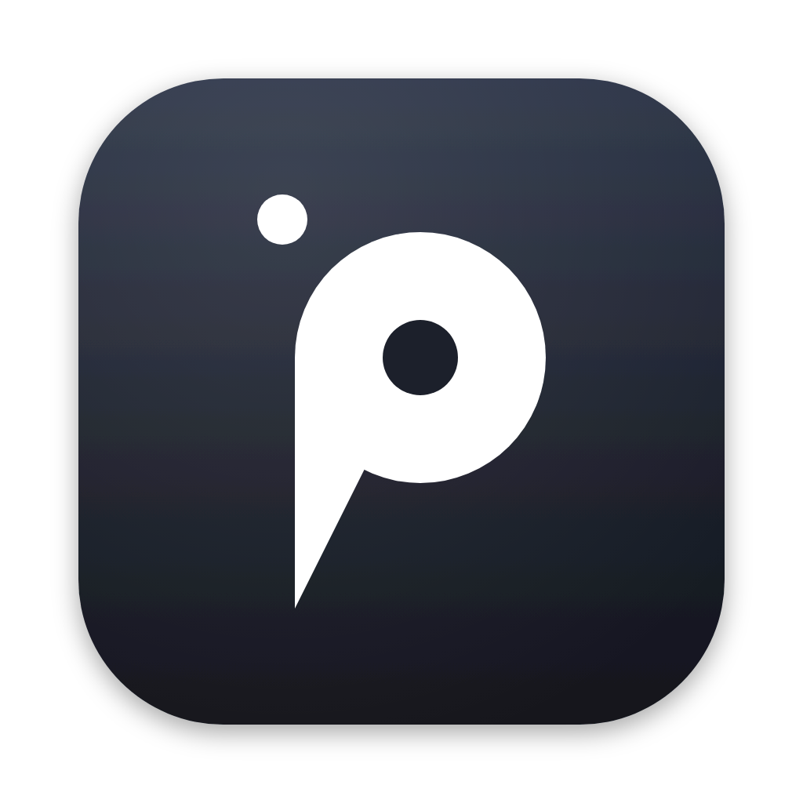
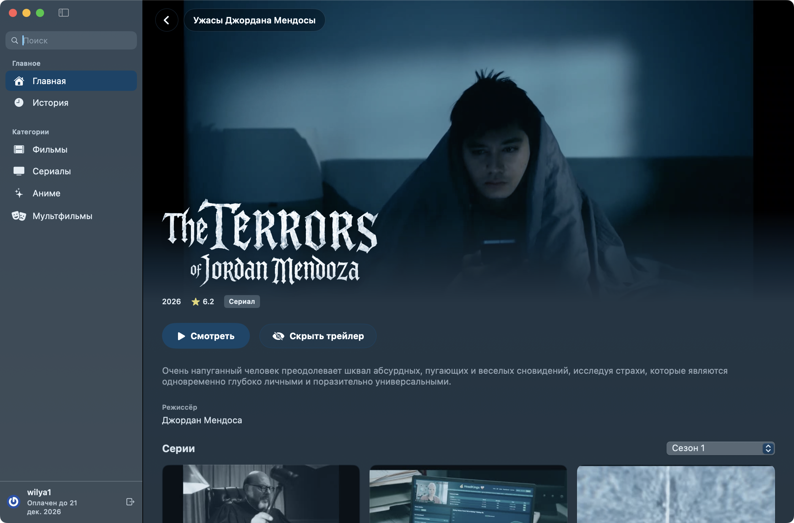
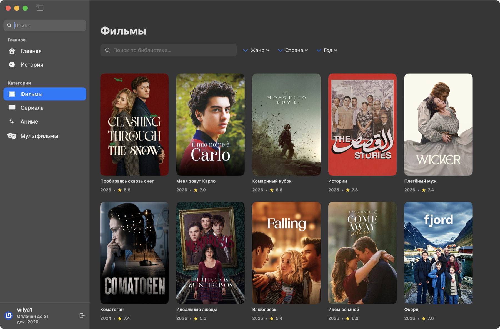
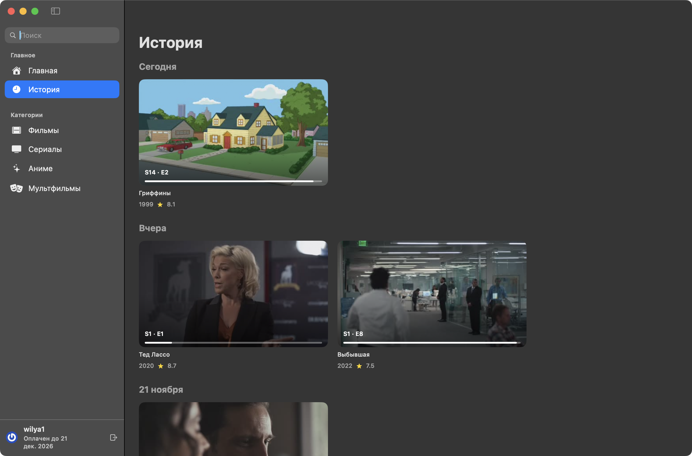

<p align="center">
  
</p>

<h1 align="center">Kinopub для macOS</h1>

<p align="center">
  Нативный клиент <a href="https://kino.pub">kino.pub</a> для macOS на SwiftUI.
  <br>Тонкий, быстрый и по-настоящему «маковский» — без Electron и лишнего.
</p>

<p align="center">
  
  
  
  
</p>

---

## ✨ Возможности

- **Каталог kino.pub** — фильмы, сериалы, аниме и мультфильмы с фильтрами по жанру, стране и году.
- **Красивый hero-слайдер** на главной — постеры в высоком качестве, рейтинги, краткое описание и кнопки «Смотреть» / «Подробнее».
- **Живые трейлеры** прямо на главной и в карточке тайтла.
- **Детальные страницы** — описание, рейтинги, сезоны и серии, актёры, похожие тайтлы.
- **Продолжить просмотр** — быстрый доступ к недосмотренному с полосой прогресса.
- **История просмотров** — сгруппирована по дням, с прогрессом и подписями серий.
- **Синхронизация прогресса** — позиция просмотра сохраняется на kino.pub в реальном времени и подхватывается на других устройствах.
- **Поиск с подсказками** — обложка и год прямо во время ввода.
- **Встроенный плеер** на AVPlayer с нативным управлением.
- **Авторизация через device-flow** kino.pub — без ввода пароля в приложении.
- **Адаптивный акцент** интерфейса под цвет открытого постера.
- **Нативная macOS-иконка** и аккуратный системный вид.

## 📸 Скриншоты

<p align="center">
  <br>
  <sub>Главная — hero-слайдер, «Продолжить просмотр», горячие фильмы</sub>
</p>

<p align="center">
  <br>
  <sub>Карточка тайтла — постер, описание, рейтинги, серии</sub>
</p>

<p align="center">
  <br>
  <sub>Категория «Фильмы» — сетка постеров и фильтры</sub>
</p>

<p align="center">
  <br>
  <sub>История просмотров — по дням, с прогрессом</sub>
</p>

<p align="center">
  <br>
  <sub>Встроенный плеер — нативные контролы, прогресс синхронизируется с kino.pub</sub>
</p>

## 🧩 Требования

- macOS 14 (Sonoma) или новее
- Для сборки из исходников: Xcode Command Line Tools (Swift 5.9+)

## 🚀 Установка

### Готовый релиз

1. Скачайте `Kinopub.app` из [раздела релизов](https://github.com/eqhow/kinopub-macos/releases/latest).
2. Перетащите **Kinopub.app** в папку «Программы» (`/Applications`).
3. Первый запуск: приложение подписано ad-hoc, поэтому — правый клик по иконке → **«Открыть»** (или `xattr -dr com.apple.quarantine /Applications/Kinopub.app`).

### Сборка из исходников

```bash
git clone https://github.com/eqhow/kinopub-macos.git
cd kinopub-macos
./build.sh
```

Скрипт соберёт release-версию и упакует её в `dist/Kinopub.app`. Дальше:

```bash
cp -R dist/Kinopub.app /Applications/
```

## ⚙️ Настройка API

По умолчанию приложение обращается к официальному API — `https://api.service-kp.com`.
Если вам нужен собственный прокси/зеркало, базовый адрес можно переопределить:

- переменной окружения:
  ```bash
  KINOPUB_API_BASE="http://ваш-адрес:порт" open -a Kinopub
  ```
- либо ключом `UserDefaults` (домен `com.kinopub.mac`):
  ```bash
  defaults write com.kinopub.mac kinopub.apiBase "http://ваш-адрес:порт"
  ```

## 🔐 Авторизация

Приложение использует официальный **device-flow** kino.pub. Войдите в аккаунт через
страницу подтверждения на сайте — пароль в приложении не хранится. Токены сохраняются
локально в `UserDefaults` и обновляются автоматически.

## 📬 Контакты

По всем вопросам, найденным багам или предложениям о сотрудничестве — пишите на почту:

**wilya1@ya.ru**

Также можно открыть [issue](https://github.com/eqhow/kinopub-macos/issues) в репозитории.

## 📄 Лицензия

Проект распространяется под лицензией [MIT](LICENSE).

---

<p align="center"><sub>Неофициальный клиент. Не связан с администрацией kino.pub.</sub></p>
